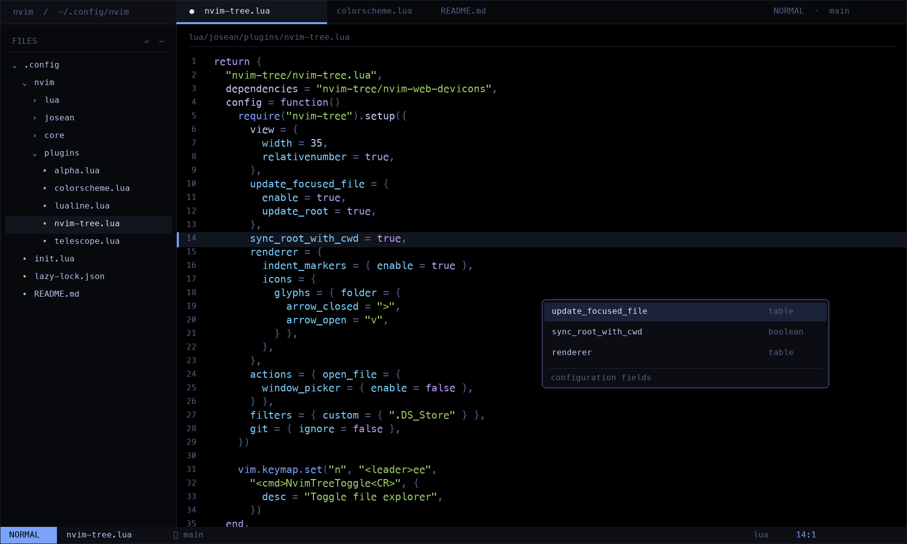
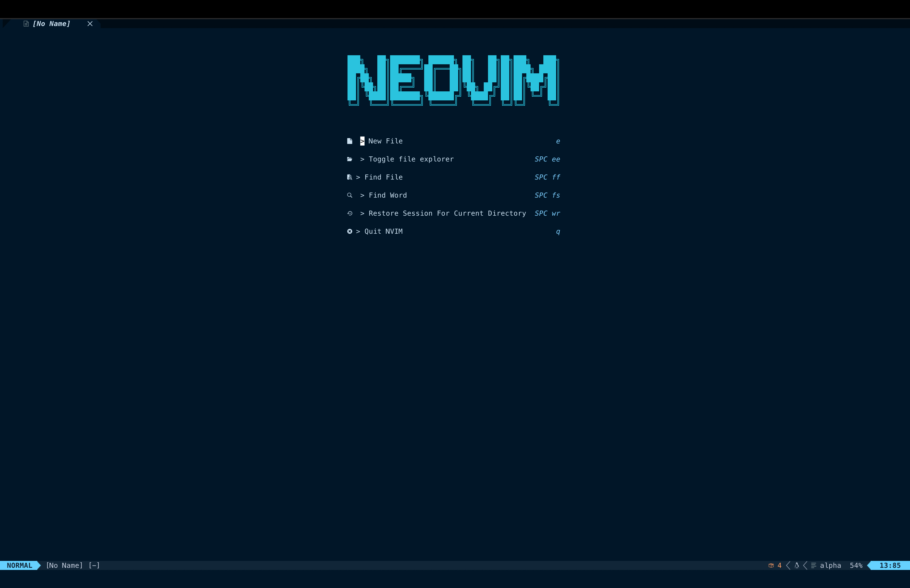
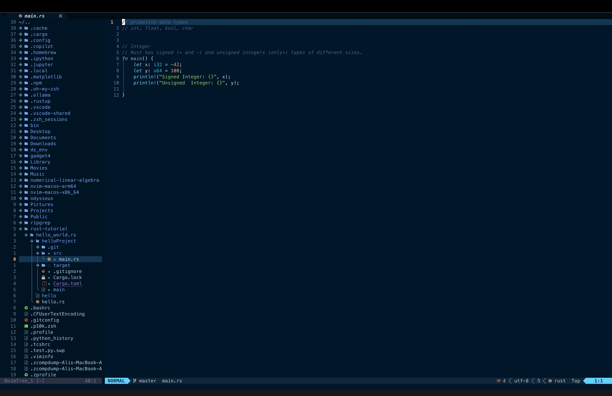

# vim-settings

My personal Neovim configuration, written in Lua and managed with lazy.nvim.
It provides LSP support, completion, syntax parsing, Git tools, file navigation,
fuzzy finding, formatting, linting, and a black Tokyo Night editing theme.

## Project layout

~~~text
init.lua
lazy-lock.json
lua/
└── josean/
    ├── core/       # Options and keymaps
    ├── plugins/    # Plugin specifications and setup
    │   └── lsp/    # Language server and Mason setup
    └── lazy.lua    # lazy.nvim bootstrap and plugin loading
~~~

## Startup flow

The entry point sets the leader key and disables netrw before loading core
settings or plugins. Core options and keymaps load before lazy.nvim imports the
plugin specifications.

~~~lua
-- init.lua
vim.g.mapleader = " "
vim.g.maplocalleader = " "

-- Let nvim-tree own directory buffers from startup.
vim.g.loaded_netrw = 1
vim.g.loaded_netrwPlugin = 1

require("josean.core") -- options and keymaps
require("josean.lazy") -- bootstrap lazy.nvim and load plugins
~~~

This order makes Space-prefixed mappings consistent and prevents netrw from
competing with nvim-tree.

## Screenshots and preview

This illustrated black-theme preview shows the configured file tree, Lua editor,
completion menu, and statusline together:

The following screenshots are earlier captures from this configuration, before
switching the palette to black:

## Example: file explorer command

A mapping specifies the mode, key sequence, and action. In normal mode, pressing
Space, then e, then e runs the NvimTreeToggle command:

~~~lua
-- lua/josean/plugins/nvim-tree.lua
vim.keymap.set("n", "<leader>ee", "<cmd>NvimTreeToggle<CR>", {
  desc = "Toggle file explorer",
})
~~~

The explorer follows the focused file and current working directory.

| Keys | Action |
| --- | --- |
| Space e e | Toggle the file explorer |
| Space e f | Find the current file in the explorer |
| Space e c | Collapse the explorer tree |
| Space e r | Refresh the explorer |

Press g? while the explorer is open to see its built-in file actions.

## Plugins

The lockfile pins the installed plugin revisions. Main plugins include:

| Plugin | Purpose |
| --- | --- |
| lazy.nvim | Plugin manager |
| telescope.nvim | Fuzzy finder |
| nvim-tree.lua | File explorer |
| nvim-treesitter | Syntax parsing |
| nvim-lspconfig, mason.nvim | Language servers and installer |
| nvim-cmp, LuaSnip | Completion and snippets |
| conform.nvim, nvim-lint | Formatting and linting |
| gitsigns.nvim, lazygit.nvim | Git integration |
| trouble.nvim | Diagnostics and references |
| tokyonight.nvim | Colorscheme, customized with a black background |
| lualine.nvim, bufferline.nvim | Statusline and buffer tabs |
| which-key.nvim | Keybinding helper |
| vim-tmux-navigator | Tmux and Neovim navigation |

LSP configuration lives in lua/josean/plugins/lsp. Open the plugin manager in
Neovim with :Lazy.

## Installation

Requirements: Neovim, Git, a C compiler/toolchain, ripgrep for Telescope, and
Node.js for language servers that need it. tmux is needed for the tmux
navigation integration.

Back up an existing Neovim configuration, then clone this repository:

~~~sh
git clone https://github.com/AliPhilip05/vim-settings.git ~/.config/nvim
nvim
~~~

lazy.nvim bootstraps itself on the first launch and installs the configured
plugins.

To pull the latest version into an existing clone:

~~~sh
cd ~/.config/nvim
git pull --ff-only origin main
~~~

## License

Use, modify, and adapt this configuration as you see fit.
